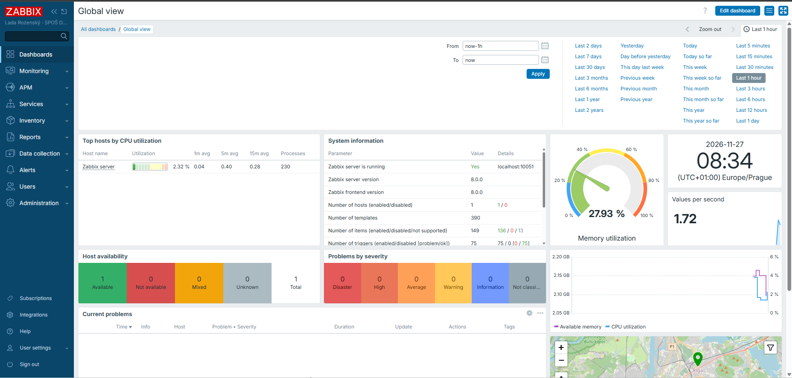
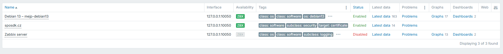
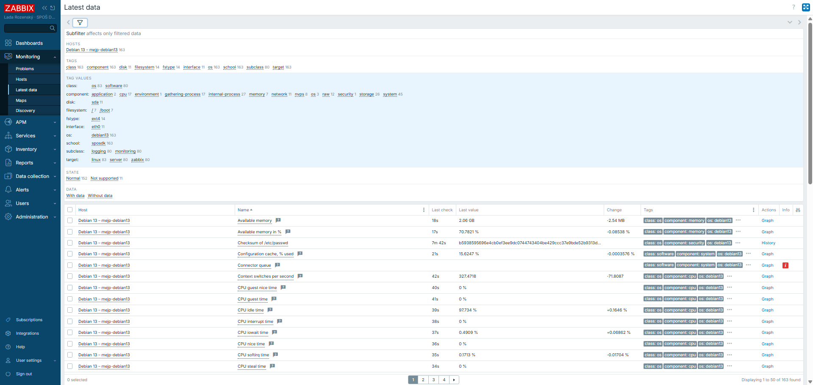
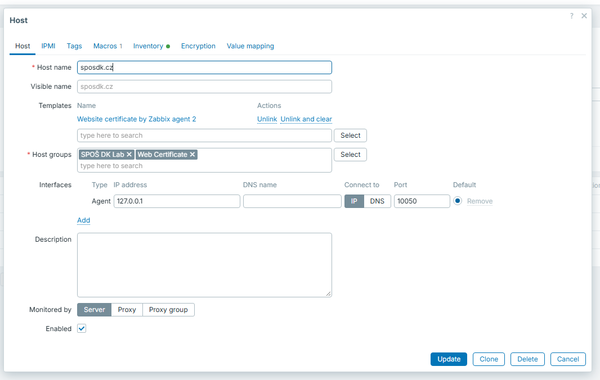
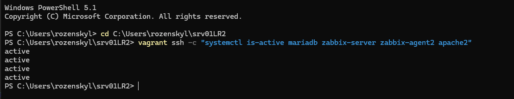

# Zabbix 8.0 LTS na Debianu 13 – Vagrant + shell skripty

**Autor:** Ladislav Rozenský · SPOŠ DK · předmět OSY, 2026

Reprodukovatelná instalace **Zabbix serveru 8.0 LTS** s databází **MariaDB**, webovým rozhraním na **Apache** a **Zabbix Agentem 2** ve virtuálním stroji **Debian 13** (`bento/debian-13`). Vše proběhne automaticky po `vagrant up`, bez ručních zásahů ve VM a bez PHP wizardu.

| Parametr | Hodnota |
| --- | --- |
| Box | `bento/debian-13` (VirtualBox) |
| Hostname VM | `mejp-debian13` |
| CPU / RAM | 3 CPU / 3072 MB |
| Web Zabbixu | **http://127.0.0.1:8080/zabbix/** (i `http://127.0.0.1:8080/` přesměruje) |
| SSH | `vagrant ssh` (port 2206 jen na `127.0.0.1`) |
| Název serveru v záhlaví | **Ladislav Rozenský · SPOŠ DK · Zabbix 8.0** |

## Předpoklady

- [Vagrant](https://developer.hashicorp.com/vagrant/install) a [VirtualBox](https://www.virtualbox.org/)
- internet (VM stahuje balíčky z Debianu a z `repo.zabbix.com`)
- volné 3 GB RAM a porty `8080` a `2206` na hostiteli

## Spuštění

```sh
git clone https://github.com/sposdknl/ladarozensky-wq-osy-2026-zbx8-inst.git
cd ladarozensky-wq-osy-2026-zbx8-inst
vagrant validate
vagrant up          # vytvoří VM a spustí oba provisioning skripty
vagrant ssh         # přihlášení do VM
vagrant provision   # opakované spuštění skriptů (databázi nezničí)
vagrant destroy -f  # smazání VM
```

Přihlášení do webu: uživatel **`Admin`**, heslo se při prvním provisioningu vygeneruje náhodně. Zobrazíte ho:

```sh
vagrant ssh -c 'sudo cat /root/zabbix-secrets/admin-password'
```

## Struktura projektu

```
Vagrantfile                      VM: Debian 13, 3 CPU, 3 GB RAM, port 8080 -> 80
scripts/install-zabbix.sh        repo Zabbix 8.0, balíčky, MariaDB, konfigurace, služby
scripts/configure-zabbix.sh      Zabbix API: místní host, import sposdk.cz, heslo Admin
Zabbix/export/sposdk.cz_hosts.yaml   export hosta sposdk.cz (ze zadání)
Images/                          snímky obrazovky
```

## Jak řešení funguje

### 1. `scripts/install-zabbix.sh`

1. Nastaví časovou zónu `Europe/Prague` a vygeneruje locale `en_US.UTF-8` (vyžaduje ho web Zabbixu).
2. Přidá **oficiální repozitář Zabbix 8.0 pro Debian 13** balíčkem `zabbix-release_latest+debian13_all.deb` z `repo.zabbix.com/zabbix/8.0/release/debian/…` (podle aktuální dokumentace Zabbix 8.0). Skript pak ověří, že `zabbix-server-mysql` má opravdu verzi 8.0.x – balíčky z repozitáře Debianu se nepoužijí.
3. Nainstaluje `mariadb-server`, `zabbix-server-mysql`, `zabbix-frontend-php`, `zabbix-apache-conf`, `zabbix-sql-scripts`, `zabbix-agent2` a `zabbix-get`.
4. Vytvoří databázi `zabbix` (`utf8mb4`, `utf8mb4_bin`) a uživatele `zabbix@localhost` s právy **jen k této databázi**.
5. Importuje `server.sql.gz` **právě jednou** – pokud v DB už existuje tabulka `dbversion`, import se přeskočí. Během importu se dočasně zapne `log_bin_trust_function_creators` podle dokumentace.
6. Do `/etc/zabbix/zabbix_server.conf` zapíše `DBName`, `DBUser`, `DBPassword` (soubor `root:zabbix`, práva `640`).
7. Agent 2 (`/etc/zabbix/zabbix_agent2.conf`): `Server=127.0.0.1`, `ServerActive=127.0.0.1`, `Hostname=mejp-debian13` – monitoruje místní server.
8. Vygeneruje **`/etc/zabbix/web/zabbix.conf.php`** s připojením k DB a s `$ZBX_SERVER_NAME`, takže se PHP wizard vůbec nezobrazí. Soubor patří `www-data`, práva `600`.
9. Nastaví PHP (`date.timezone`, limity), přesměrování `/` → `/zabbix/`, ověří `apache2ctl configtest`.
10. Povolí a restartuje `mariadb`, `zabbix-server`, `zabbix-agent2`, `apache2` a zkontroluje, že všechny běží.

### 2. `scripts/configure-zabbix.sh` (Zabbix API, `curl` + `jq`)

1. Počká, až API odpoví, a ověří, že jde o verzi 8.0.x.
2. Založí hosta **`mejp-debian13`** (viditelný název *Debian 13 – mejp-debian13*) s rozhraním agenta `127.0.0.1:10050`, šablonami **Linux by Zabbix agent** (funguje s Agentem 2) a **Zabbix server health**, ve skupinách *Linux servers* a *SPOŠ DK Lab*. Výchozího hosta *Zabbix server* vypne, aby se stejný agent nesledoval dvakrát.
3. Importuje **`Zabbix/export/sposdk.cz_hosts.yaml`** přes `configuration.import` – vznikne host `sposdk.cz` se šablonou **Website certificate by Zabbix agent 2** a makrem `{$CERT.WEBSITE.HOSTNAME}=sposdk.cz`. Certifikát stahuje místní Agent 2 (plugin WebCertificate, klíč `web.certificate.get`).
4. Požádá server o okamžitý sběr („Execute now“), aby data v *Latest data* nebyla prázdná do prvního intervalu.
5. Při prvním běhu změní výchozí heslo `Admin` / `zabbix` na náhodné a uloží ho do `/root/zabbix-secrets/admin-password`.

Všechny kroky nejdřív kontrolují, jestli objekt už existuje, takže `vagrant provision` nic nezdvojí.

### Export `sposdk.cz` a Zabbix 8.0

Export ze zadání má `version: '7.0'`. Zabbix 8.0 starší exporty při importu sám převede na aktuální formát a na Debianu je k dispozici Agent 2 i šablona *Website certificate by Zabbix agent 2*, takže **export není potřeba upravovat** – odevzdávám ho beze změny. Rozhraní hosta je v exportu uvedené jen jako `interface_ref: if1`; výchozí hodnoty (agent, `127.0.0.1`, port `10050`) Zabbix při importu doplní.

Pro jistotu má skript zálohu: kdyby import selhal, vytvoří hosta `sposdk.cz` se stejnou šablonou, makrem a rozhraním přímo přes `host.create` a dál ověří, že má host šablonu i makro.

## Hesla a bezpečnost

- V repozitáři, README ani historii Gitu **nejsou žádná hesla**.
- Heslo k databázi se generuje ve VM (`openssl rand -hex 24`) do **`/root/zabbix-secrets/db-password`** (adresář `700`, soubor `600`). Odtud ho skript doplní do `zabbix_server.conf` a `zabbix.conf.php`.
- Volitelně jde heslo předat z hostitele proměnnou prostředí: `ZBX_DB_PASSWORD=MojeDlouheHeslo123 vagrant up` (min. 12 znaků, písmena, číslice, `. _ -`). Vagrantfile ho jen přepošle skriptu, nikam se neukládá.
- Výchozí heslo `Admin` se mění na náhodné (`/root/zabbix-secrets/admin-password`).
- Při opakovaném `vagrant provision` se použijí uložená hesla – DB zůstane funkční.
- Web i SSH jsou přesměrované jen na `127.0.0.1` hostitele; `.gitignore` vylučuje `.vagrant/`, disky VM a soubory s hesly.

## Ověření

Ve VM (`vagrant ssh`):

```sh
systemctl is-active mariadb zabbix-server zabbix-agent2 apache2
systemctl status zabbix-server --no-pager
zabbix_server -V | head -1
zabbix_agent2 -V | head -1
zabbix_get -s 127.0.0.1 -k agent.version
zabbix_get -s 127.0.0.1 -k 'web.certificate.get[sposdk.cz]' | jq .x509.not_after
```

Ve webu **http://127.0.0.1:8080/zabbix/**:

1. V záhlaví je název **Lada Rozenský · SPOŠ DK · Zabbix 8.0**.
2. **Data collection → Hosts** – `mejp-debian13` a `sposdk.cz` mají zelenou ikonu **ZBX**.
3. **Monitoring → Latest data**, host `mejp-debian13` – aktuální hodnoty z agenta (CPU, paměť, disky…).
4. **Monitoring → Latest data**, host `sposdk.cz` – položky *Cert: …* (dny do vypršení, platnost od/do, vydavatel, výsledek ověření). Položky vzniknou přes discovery, první hodnoty se objeví do pár minut.

## Snímky obrazovky

| | |
| --- | --- |
| Web s vlastním názvem serveru |  |
| Hosté a dostupnost agenta |  |
| Latest data – místní Debian 13 |  |
| Latest data – certifikát `sposdk.cz` |  |
| Běžící služby (`systemctl`) |  |

## Řešení potíží

- **`vagrant up` skončí při stahování z `repo.zabbix.com`** – zkontrolujte síť/DNS ve VM (`vagrant ssh -c 'ping -c1 repo.zabbix.com'`) a spusťte znovu `vagrant provision`. Skript naváže tam, kde skončil.
- **Port 8080 je obsazený** – změňte `host: 8080` ve `Vagrantfile` a spusťte `vagrant reload`.
- **Web hlásí chybu databáze** – `sudo systemctl status mariadb`, `sudo tail -50 /var/log/zabbix/zabbix_server.log`.
- **Host má červenou ikonu ZBX** – `sudo systemctl status zabbix-agent2`, `zabbix_get -s 127.0.0.1 -k agent.ping`.
- **Certifikát `sposdk.cz` nemá data** – VM musí dosáhnout na `sposdk.cz:443`; otestujte `zabbix_get -s 127.0.0.1 -k 'web.certificate.get[sposdk.cz]'`. Discovery položek může chvíli trvat, případně v *Data collection → Hosts → sposdk.cz → Discovery* klikněte na **Execute now**.
- **Zapomenuté heslo Admin** – `vagrant ssh -c 'sudo cat /root/zabbix-secrets/admin-password'`.
- **Málo RAM na hostiteli** – ve `Vagrantfile` lze snížit `vb.memory` (Zabbix s MariaDB ale pod ~1,5 GB běží pomalu).

## Zdroje

- [Zabbix – Download and install](https://www.zabbix.com/download)
- [Zabbix 8.0 – instalace z balíčků](https://www.zabbix.com/documentation/8.0/en/manual/installation/install_from_packages)
- [Zabbix 8.0 – požadavky](https://www.zabbix.com/documentation/8.0/en/manual/installation/requirements)
- [Zabbix 8.0 – Monitor website certificates with Zabbix agent 2](https://www.zabbix.com/documentation/8.0/en/manual/guides/monitor_certificate)
- [Zabbix 8.0 – API](https://www.zabbix.com/documentation/8.0/en/manual/api)
- [Ukázkové řešení na FreeBSD (sposdknl/smejdil-osy-2026-zbx8-inst)](https://github.com/sposdknl/smejdil-osy-2026-zbx8-inst)
